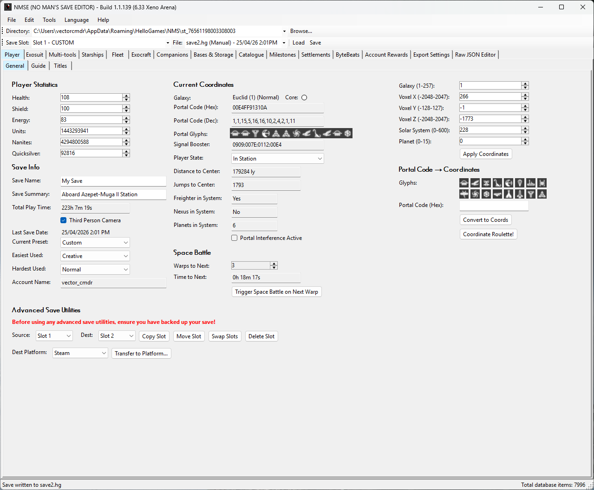
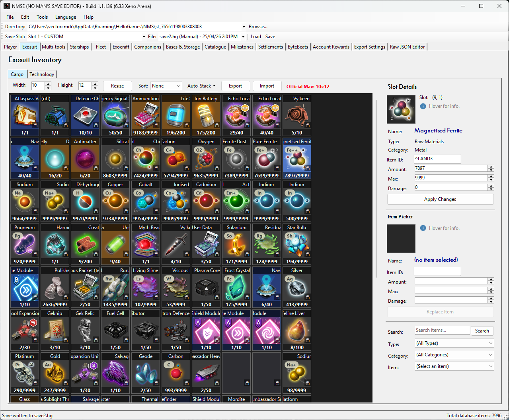
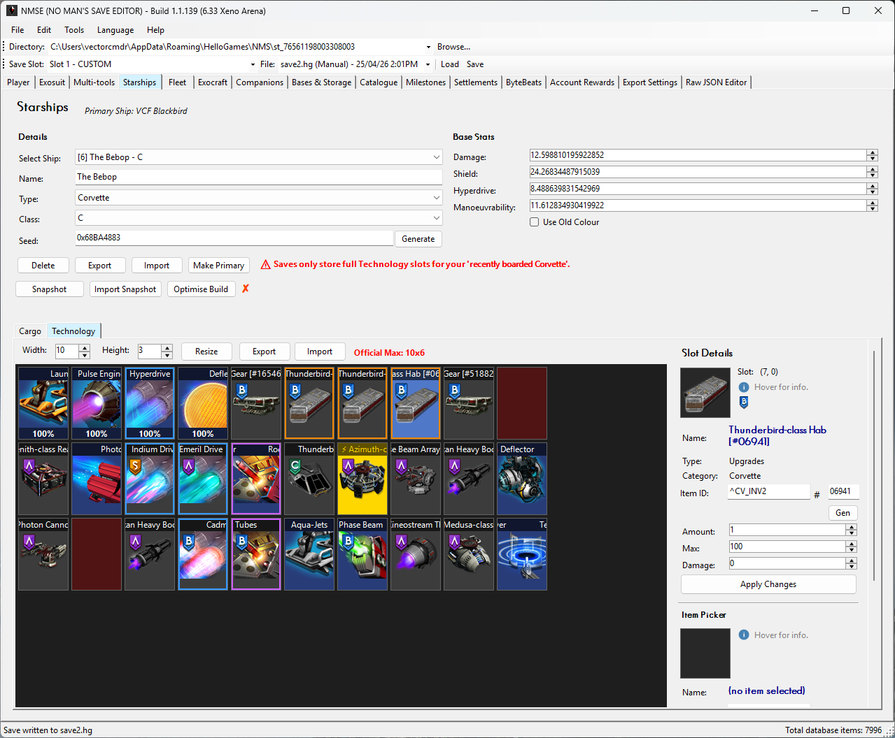
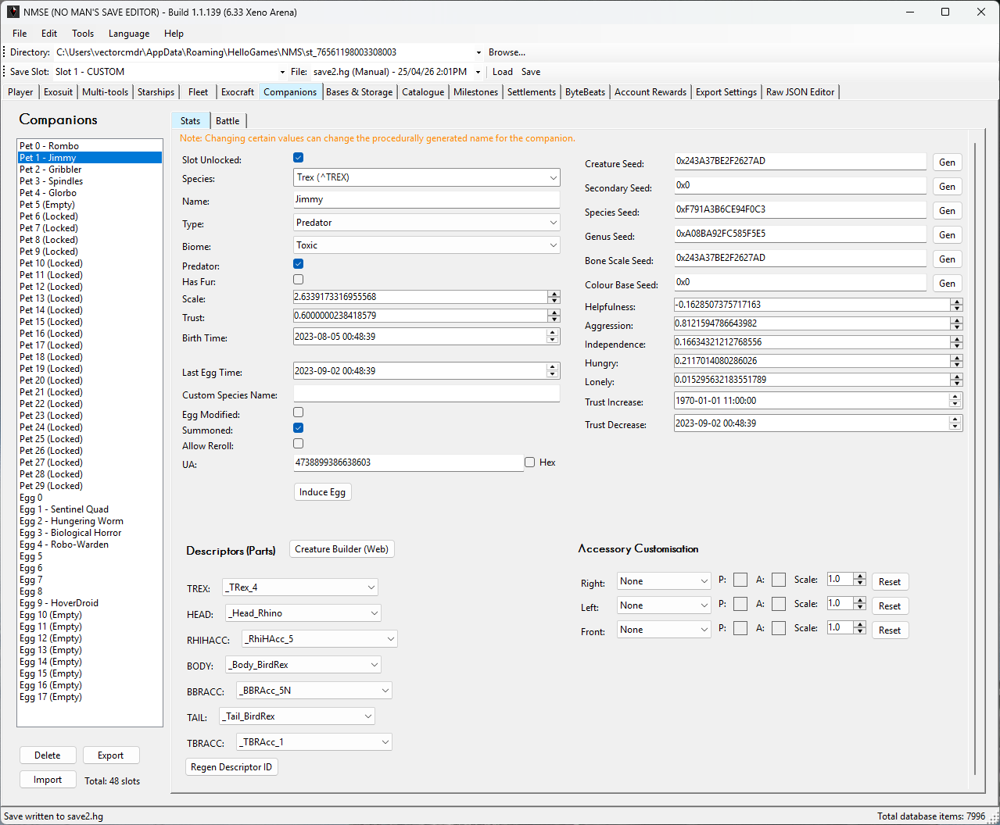
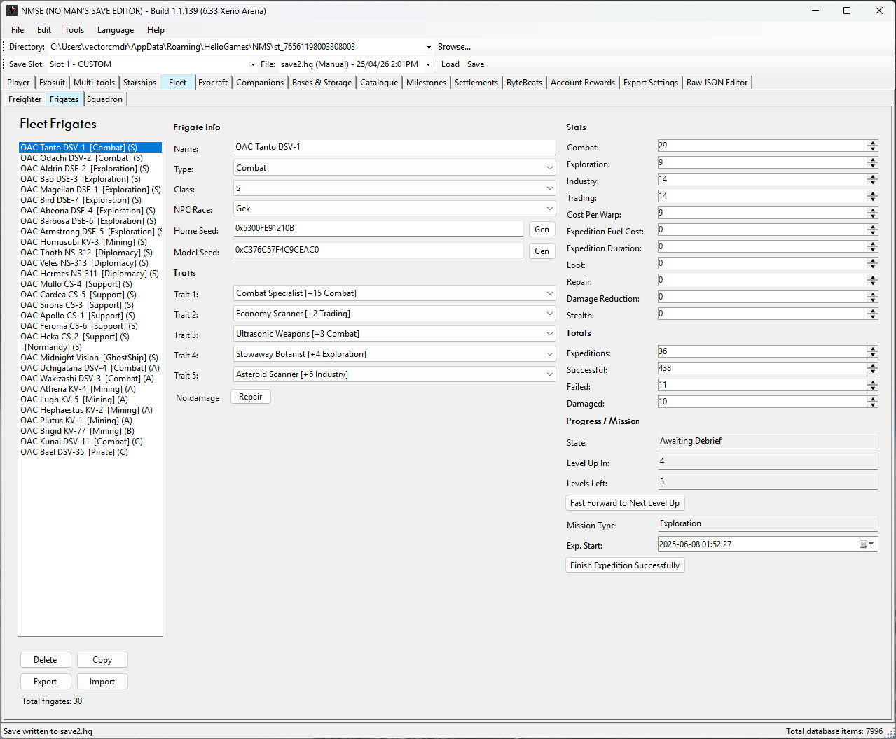
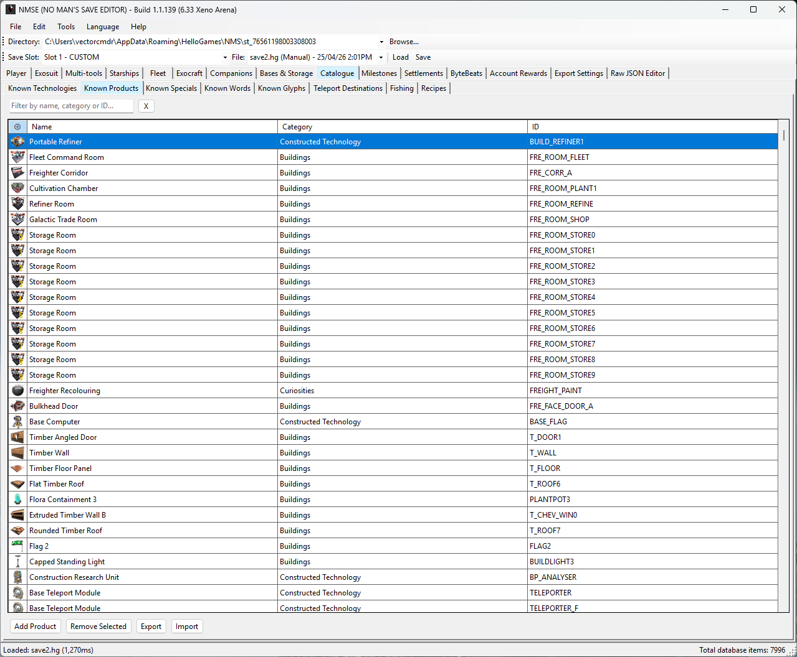
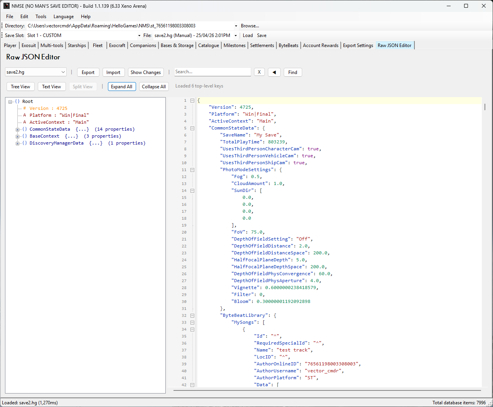
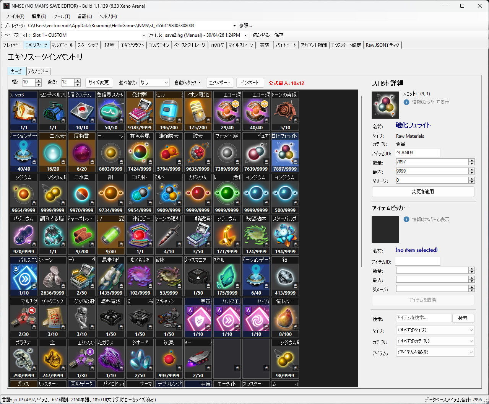

<div align="center">

# NMSE (No Man's Save Editor)

[![Build Status][badge-build]][workflow-build]
[![GitHub Release][badge-release]][releases]
[![GitHub Stars][badge-stars]][repo] <br />
[![License][badge-license]][license]
[![Platform][badge-platform]][releases]
[![.NET][badge-dotnet]][dotnet]


**NMSE** is a free, open-source desktop application for editing *No Man's Sky* save files.<br />
It boasts the most complete set of editable features among editors and supports every platform the game ships on; <br />
**Steam**, **GOG**, **Xbox Game Pass**, **PlayStation 4** & **Nintendo Switch**.<br />

[**Download Latest Release**][releases] · [**See The Website**][website] · [**Report a Bug**][issues-bug] · [**Request a Feature**][issues-feature] <br />
[**User Guide**][user-guide]

> *The user guide may lag behind builds.*

> **Latest Supported Game Version:** 7.11 _**Forsaken**_

</div>

---

## ✨ Features Summary

<table>
<tr>
<td width="50%" valign="top">

### 👨‍🚀 Player & Stats
- Edit health, currency, units, nanites, quicksilver
- Switch game mode and difficulty presets
- Modify player state and galactic coordinates
- Unlock words, glyphs, and discoveries
- Full milestone and journey milestone editing
- Edit multi-tool inventory, type, class, and seed
- Edit known items (product, tech, recipes, etc.)
- Catalogue completion tools for knowledge pages, wonders, fossils and raw materials
- Outfit export/import
- Titles, guide tab and experimental multiplayer (co-op) keys

### 🏗️ Bases, Settlements
- Edit base inventories and storage chests
- Settlement stats, production, and perks
- Edit corvette cache and salvage containers
- Edit fishing inventories and cooking ingredients
- Systems: space station stats, Cosmos mission states and Space POI discovery editing
- Base object editor (advanced)

### 🦎 Companion Pets
- Companion editing
- Custom creature builder
- Pet battle editing
- Pet battle stat seed search (stamped with `0xC0D3`)

</td>
<td width="50%" valign="top">

### 🚀 Starships, Exocraft & Fleets
- Edit starships with full inventory access
- Change ship type, class, seed, and name
- Corvette editing, part reverse lookup, export and import
- Corvette build optimiser
- Starship customisation (model, textures, colours) and ship archive
- Manage exocraft inventories and tech
- Full freighter inventory editing and room listing
- Manage frigate fleet stats and traits
- Squadron pilot and ship editing
- Multi-tool archive (move/import)

### 🗃️ Inventories & More
- Visual inventory grid editor for every slot type
- Drag-and-drop item management
- Auto-stack items from exosuit/starship to freighter/chests/starship
- Sort inventory
- Import/export practically everything (cross-editor compatible)
- Database Search panel (lookup without a loaded save)
- Backup picker and restore
- Procedural tech stat/seed searcher
- ByteBeat music library editor
- Recipe browser with full crafting trees
- Raw JSON tree viewer for advanced editing
- Export/import editor configuration profiles
- Built-in update checker
- Light/Dark mode

</td>
</tr>
</table>

For a full breakdown of all of the features, refer to the [**User Guide**][user-guide]

### 🌍 Multi-Language Support

NMSE is localised in **16 languages**: English (UK), English (US), French, Italian, German, Spanish, Russian, Polish, Dutch, Portuguese, Latin American Spanish, Brazilian Portuguese, Simplified Chinese, Traditional Chinese, Japanese and Korean. Any help in making language support more natural is welcome!

---

## 🗺️ Roadmap

You can view the NMSE development roadmap **[here][roadmap]** for upcoming, planned and dreamt about features.

---

## 📸 Screenshots

<table style="width: 100%; border-collapse: collapse; margin-bottom: 1em; margin-left: auto; margin-right: auto;">
  <tr>
    <th style="width: 25%; text-align: center; padding: 8px;">Player</th>
    <th style="width: 25%; text-align: center; padding: 8px;">Inventories</th>
    <th style="width: 25%; text-align: center; padding: 8px;">Corvettes</th>
    <th style="width: 25%; text-align: center; padding: 8px;">Companions</th>
  </tr>
  <tr>
    <td style="padding: 8px;"></td>
    <td style="padding: 8px;"></td>
    <td style="padding: 8px;"></td>
    <td style="padding: 8px;"></td>
  </tr>
  <tr>
    <th style="width: 25%; text-align: center; padding: 8px;">Fleet</th>
    <th style="width: 25%; text-align: center; padding: 8px;">Catalogue</th>
    <th style="width: 25%; text-align: center; padding: 8px;">JSON Editor</th>
    <th style="width: 25%; text-align: center; padding: 8px;">Localisation</th>
  </tr>
  <tr>
    <td style="padding: 8px;"></td>
    <td style="padding: 8px;"></td>
    <td style="padding: 8px;"></td>
    <td style="padding: 8px;"></td>
  </tr>
</table>

---

## 📥 Installation

### Windows: Quick Start

1. Download the latest release from the [**Releases**][releases] page
2. Extract the zip to a folder of your choice
3. Run `NMSE.exe`
4. Select your save slot and click <kbd>Load</kbd>
5. If your save location is not auto-detected, use the <kbd>Browse...</kbd> button or <kbd>File > Open Save Directory</kbd> to locate your save directory

> 💡 **Tip:** _NMSE auto-detects your save file location for Steam, GOG, and Xbox Game Pass_

### Linux & macOS:

Wine based AppImage and DMG are available from the release page.<br>
See the cross-platform guides for running NMSE via Wine:

- 🐧 Linux AppImage with WINE included **(RECOMMENDED)**
- 🥃 [Gcenx Wine Builds on macOS][guide-gcenx-wine] (free, recommended for macOS)
- 🍎 [CrossOver on macOS][guide-crossover] (paid, supported)
- Advanced usage under Linux: 🍷 [Wine on Linux][guide-wine] or 🧴 [Bottles on Linux][guide-bottles]

NMSE is a Windows app that also runs on Linux/macOS via Wine compatibility layers (AppImage/DMG provided). Options for a native port are under review. Release assets are named `NMSE-<version>-Release.zip`, `NMSE-<version>-Release-x64.AppImage` and `NMSE-<version>-Release-x64.dmg`.

---

## 📖 Documentation

* **[User Guide][user-guide]** - How to use NMSE panel by panel, feature by feature
* **[Developer Docs][dev-docs]** - Architecture, core logic, data layer, IO, models, and UI internals
* **[Contributing][contributing]** - How to contribute code, report bugs, and submit pull requests
* **[Code of Conduct][code-of-conduct]** - Community guidelines
* **[Support][support]** - How to get help

---

## 📄 License

NMSE is licensed under the **GNU Affero General Public License** - see the [LICENSE][license] file for details.

**Reversed game code:** Parts of NMSE are reverse engineered from No Man's Sky and reimplemented for save interoperability only. Those parts are game-derived, are not covered by the project's AGPL licence, and are not intended for wholesale reuse or redistribution in other tools.

---

## 🛠️ Building from Source

```bash
# Clone the repository
git clone https://github.com/vectorcmdr/NMSE.git
cd NMSE

# Restore and build
dotnet restore
dotnet build

# Run tests
dotnet test NMSE.Tests/
dotnet test NMSE.Extractor.Tests/
```

> **Requires:** [.NET 10.0 SDK][dotnet] · Windows or cross-compilation via `EnableWindowsTargeting`

---

## 💖 Support the Project

If NMSE has been useful to you, please consider supporting its development:

<div align="center">

[![GitHub Sponsors][badge-sponsor]][sponsor]&nbsp;&nbsp;
[![Ko-fi][badge-kofi]][kofi]

</div>

Your support helps cover hosting, tooling, and the many hours of development and testing that go into each release.<br>
Every contribution - big or small - is greatly appreciated. ❤️

### Public Sponsors:

Thanks to these users for their generous support:


---

## 🤝 Acknowledgements

- **[Hello Games][hello-games]** for creating No Man's Sky
- The NMS modding and save editing community
- All [contributors][contributors] and [sponsors][sponsor] who help make NMSE better

### Contributors:


---

<div align="center">

Made with ❤️ by [**vectorcmdr**][github-owner]

[![GitHub][badge-github]][github-owner] · [![Discord][badge-discord]][discord]

</div>

<!-- Link Definitions --------------------->

<!-- Badges -->
[badge-build]: https://img.shields.io/github/actions/workflow/status/vectorcmdr/NMSE/build-nmse.yml?branch=main&label=build&logo=github
[badge-license]: https://img.shields.io/badge/license-AGPL%203.0-4a8fff
[badge-dotnet]: https://img.shields.io/badge/.NET-10.0-512BD4?logo=dotnet&logoColor=white
[badge-release]: https://img.shields.io/github/v/release/vectorcmdr/NMSE?include_prereleases&label=⇓%20release&color=green
[badge-stars]: https://img.shields.io/github/stars/vectorcmdr/NMSE?style=flat&color=yellow&label=★%20stars
[badge-platform]: https://img.shields.io/badge/platform-Windows-0078D4?logo=windows&logoColor=white
<!-- Unused for now; may be re-enabled when the badge is refreshed for the current game version.
[badge-gamever]: https://img.shields.io/badge/game%20version-6.34-7644e3?logo=windows&logoColor=white
-->
[badge-sponsor]: https://img.shields.io/badge/Sponsor-GitHub%20Sponsors-ea4aaa?logo=githubsponsors&logoColor=white
[badge-kofi]: https://img.shields.io/badge/Support-Ko--fi-29abe0?logo=ko-fi&logoColor=white
[badge-github]: https://img.shields.io/badge/GitHub-vectorcmdr-181717?logo=github&logoColor=white
[badge-discord]: https://img.shields.io/badge/Discord-Join%20Chat-5865F2?logo=discord&logoColor=white

<!-- Project Links -->
[repo]: https://github.com/vectorcmdr/NMSE
[releases]: https://github.com/vectorcmdr/NMSE/releases/latest
[license]: LICENSE
[issues-bug]: https://github.com/vectorcmdr/NMSE/issues/new?template=bug_report.md
[issues-feature]: https://github.com/vectorcmdr/NMSE/issues/new?template=feature_request.md
[contributors]: https://github.com/vectorcmdr/NMSE/graphs/contributors
[workflow-build]: https://github.com/vectorcmdr/NMSE/actions/workflows/build-nmse.yml

<!-- Documentation -->
[user-guide]: docs/user/README.md
[dev-docs]: docs/dev/README.md
[contributing]: .github/CONTRIBUTING.md
[code-of-conduct]: .github/CODE_OF_CONDUCT.md
[support]: .github/SUPPORT.md
[roadmap]: https://github.com/vectorcmdr/NMSE/projects?query=is%3Aopen

<!-- Cross-Platform Guides -->
[guide-wine]: docs/dev/wine-linux-guide.md
[guide-bottles]: docs/dev/bottles-linux-guide.md
[guide-gcenx-wine]: docs/dev/gcenx-macos-guide.md
[guide-crossover]: docs/dev/crossover-macos-guide.md

<!-- External -->
[dotnet]: https://dotnet.microsoft.com/download/dotnet/10.0
[hello-games]: https://hellogames.org
[github-owner]: https://github.com/vectorcmdr
[sponsor]: https://github.com/sponsors/vectorcmdr
[kofi]: https://ko-fi.com/vector_cmdr
[discord]: https://discord.gg/WbDQKKP3us
[website]: https://nmse.vectorcmdr.xyz
